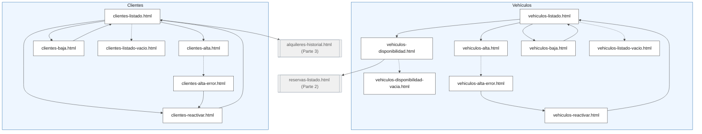

# Fase 5 — Parte 1: Mockups de Vehículos y Clientes (Johann-Tafur)

**Alcance**: E1 Vehículos + E2 Clientes (back-office del empleado). Ver división completa en
`docs/05-mockups/00-asignacion.md`, sección 5.

Cada pantalla es un único HTML responsive en `docs/05-mockups/prototipo/`, copiado de
`plantilla.html` y con los estilos de `estilos.css` (sección 1 de la asignación). Los datos de
ejemplo son los de `docs/04-base-de-datos/sql/02-dml.sql`, para que los mockups sean coherentes
con la base: los mismos vehículos, clientes, reservas y alquileres aparecen una y otra vez entre
pantallas, incluidos los casos que bloquean una acción (RN08) o que ofrecen reactivar un registro
dado de baja (RN16).

## 1. Vehículos

### 1.1 `vehiculos-listado.html` (pantalla de entrada)

- **Objetivo**: ver de un vistazo el estado de la flota y llegar a las demás acciones.
- **Historias / RF**: US1.2 (RF05, RF06, RF47).
- **Campos**: filtro por estado (`Todos menos Retirados` por defecto, incluye `Retirado` como
  opción explícita — RF47).
- **Columnas**: patente, vehículo (marca + modelo + año), precio por día, estado, acciones.
- **Acciones por fila** (según estado, usando los datos del DML):
  - `AB123CD` (Disponible, sin reservas ni alquiler activo): Editar, Marcar mantenimiento, Dar de
    baja.
  - `AC456EF` (Alquilado, con un alquiler ACTIVO): solo Editar — "Marcar mantenimiento" y "Dar de
    baja" no se ofrecen porque RF15 y RF11 los bloquean mientras el alquiler esté activo.
  - `AD789GH` (Disponible, con una reserva Pendiente): Editar, Marcar mantenimiento — "Dar de
    baja" no se ofrece porque RF46 lo bloquea mientras tenga reservas Pendientes/Confirmadas (el
    mantenimiento sí se permite: RF15 solo mira el alquiler activo).
  - `AE012IJ` (Mantenimiento, sin reservas ni alquiler): Editar, Desmarcar mantenimiento, Dar de
    baja.
  - `AF345KL` (Retirado): solo aparece con el filtro en `Retirado`; su única acción es Reactivar.
- **Estado especial**: `vehiculos-listado-vacio.html` — listado sin resultados para el filtro
  elegido (nunca dice "no hay vehículos", siempre nombra el filtro aplicado).
- **Móvil**: estándar (resuelto por `estilos.css`: cada fila se ve como tarjeta).

### 1.2 `vehiculos-alta.html` + `vehiculos-alta-error.html`

- **Objetivo**: registrar un vehículo nuevo o editar uno existente.
- **Historias / RF**: US1.1, US1.3, US1.7 (RF01-RF04, RF07-RF09, RF49).
- **Campos obligatorios** (`*`): patente, marca, modelo, precio por día. Año y tipo son opcionales
  en el mockup (RF01 los lista, pero no son parte de las reglas de obligatoriedad de RF02/RF09).
- **Acciones**: Guardar (vuelve al listado), Cancelar (vuelve al listado sin guardar).
- **Errores** (`vehiculos-alta-error.html`, dos variantes por separado):
  - Variante A — patente duplicada de un vehículo **activo** (`AC456EF`): rechazo simple, mensaje
    debajo del campo (RF03, RNF01).
  - Variante B — patente duplicada de un vehículo **Retirado** (`AF345KL`): el aviso general
    aclara que existe pero está dado de baja, y el botón de guardar se reemplaza por "Reactivar
    vehículo AF345KL", que lleva a `vehiculos-reactivar.html` (RF49, RN16).
- **Móvil**: estándar.

### 1.3 `vehiculos-baja.html` y `vehiculos-reactivar.html`

- **Objetivo**: dar de baja (lógica) o reactivar un vehículo, sin perder su historial (RN15).
- **Historias / RF**: US1.4, US1.7 (RF10, RF11, RF46-RF48).
- **Confirmación de baja** (nunca dice "eliminar"): explica que el vehículo pasa a Retirado, deja
  de verse en listados y búsquedas, conserva su historial y se puede reactivar.
- **Bloqueos mostrados como variante en la misma pantalla** (no se llega a la confirmación):
  - Alquiler Activo en curso (`AC456EF`, RF11).
  - Reserva Pendiente o Confirmada (`AD789GH`, RF46).
- **Reactivar** (`vehiculos-reactivar.html`): confirmación positiva, sin bloqueos — un vehículo
  Retirado siempre se puede reactivar (RF48).
- **Móvil**: estándar.

### 1.4 `vehiculos-disponibilidad.html` + `vehiculos-disponibilidad-vacia.html`

- **Objetivo**: buscar vehículos disponibles en un rango de fechas, para ofrecérselos a un cliente
  que llama (US1.5) — misma lógica que usa la búsqueda pública (US5.1).
- **Historias / RF**: US1.5 (RF12, RF13).
- **Campos obligatorios**: fecha desde, fecha hasta.
- **Resultado**: lista de vehículos sin solapamiento de reserva/alquiler y sin estar Retirados ni
  en Mantenimiento, con una acción "Reservar" que lleva a `reservas-listado.html` (Parte 2).
- **Estado especial**: `vehiculos-disponibilidad-vacia.html` — "No hay unidades disponibles para
  el rango de fechas pedido" (criterio de aceptación de US1.5).
- **Móvil**: estándar.

## 2. Clientes

### 2.1 `clientes-listado.html` (pantalla de entrada)

- **Objetivo**: buscar un cliente existente antes de cargarlo de nuevo, y llegar a sus acciones.
- **Historias / RF**: US2.2 (RF19, RF20, RF50).
- **Campos**: búsqueda por documento o apellido, checkbox "Incluir inactivos" (RF50, no marcado
  por defecto).
- **Columnas**: documento, nombre, contacto, estado, acciones.
- **Acciones por fila**:
  - `30111222` Lucía Fernández (Activo, con alquiler ACTIVO): Editar, Historial — sin
    "Desactivar", bloqueado por RF24.
  - `28333444` Martín Gómez (Activo, con reserva Pendiente): Editar, Historial — sin
    "Desactivar", también bloqueado por RF24.
  - `35555666` Sofía Pereyra (Activo, sin actividad pendiente): Editar, Desactivar, Historial.
  - `27777888` Diego Ramírez (Inactivo, solo visible con "Incluir inactivos"): Reactivar,
    Historial.
  - El link "Historial" de cada fila lleva a `alquileres-historial.html` (Parte 3, US4.4): el
    historial se puede consultar aunque el cliente esté inactivo.
- **Estado especial**: `clientes-listado-vacio.html` — búsqueda sin resultados.
- **Móvil**: estándar.

### 2.2 `clientes-alta.html` + `clientes-alta-error.html`

- **Objetivo**: registrar un cliente nuevo o editar uno existente.
- **Historias / RF**: US2.1, US2.3, US2.5 (RF16-RF18, RF21, RF22, RF52).
- **Campos obligatorios** (`*`): nombre, apellido, documento. Email y teléfono son opcionales en
  esta pantalla (en el formulario público, US5.2, al menos uno de los dos es obligatorio — ver
  Parte 2).
- **Errores** (`clientes-alta-error.html`, dos variantes por separado):
  - Variante A — documento duplicado de un cliente **activo** (`28333444`): rechazo simple
    (RF18, RNF01).
  - Variante B — documento duplicado de un cliente **inactivo** (`27777888`): el aviso general
    ofrece reactivar en vez de rechazar sin más, con un botón "Reactivar cliente 27777888" que
    lleva a `clientes-reactivar.html` (RF52, RN16).
- **Móvil**: estándar.

### 2.3 `clientes-baja.html` y `clientes-reactivar.html`

- **Objetivo**: desactivar o reactivar un cliente, sin perder su historial (RN15).
- **Historias / RF**: US2.4, US2.5 (RF23, RF24, RF50, RF51).
- **Confirmación de baja** (nunca dice "eliminar"): explica que el cliente queda Inactivo, deja de
  aparecer en las búsquedas por defecto, conserva su historial y se puede reactivar (a mano, o
  automáticamente si vuelve a reservar por el formulario público — RF58).
- **Bloqueos mostrados como variante en la misma pantalla**:
  - Alquiler Activo en curso (Lucía Fernández, RF24).
  - Reserva Pendiente o Confirmada (Martín Gómez, RF24).
- **Reactivar** (`clientes-reactivar.html`): confirmación positiva, sin bloqueos (RF51).
- **Móvil**: estándar.

## 3. Capturas

Pendientes de tomar (375 px y 1280 px) para las 4 pantallas principales
(`vehiculos-listado.html`, `vehiculos-alta.html`, `clientes-listado.html`, `clientes-alta.html`)
y guardar en `docs/05-mockups/capturas/`, con el nombre de la pantalla y el sufijo
`-movil.png` / `-web.png` (sección 2.3 de la asignación). Se completan en un commit aparte una vez
revisado el prototipo en el navegador.

## 4. Diagrama de navegación

Fuente editable: `docs/05-mockups/fuentes/parte1-navegacion-vehiculos-clientes.mmd`. Las flechas
punteadas son los links a una variante de estado especial (listado vacío, error); las sólidas son
el flujo principal. `reservas-listado.html` y `alquileres-historial.html` son de otras partes:
mientras no estén en `main`, esos links dan "archivo no encontrado" (igual que aclara
`prototipo/index.html`).

## 5. Qué falta validar

- [ ] Revisar el prototipo en el navegador a 375 px y 1280 px (las 14 pantallas de esta parte).
- [ ] Tomar las capturas de las 4 pantallas principales (sección 3) y subirlas.
- [ ] Confirmar con chaarlyez que los links hacia `reservas-listado.html` usan el nombre de
      pantalla de entrada correcto una vez que su parte esté en `main`.
- [ ] Confirmar con mariocardona970546 que `alquileres-historial.html` es el nombre final de esa
      pantalla antes de la integración.
- [ ] Completar la fila de la Parte 1 en `docs/05-mockups/fuentes/README.md`.
