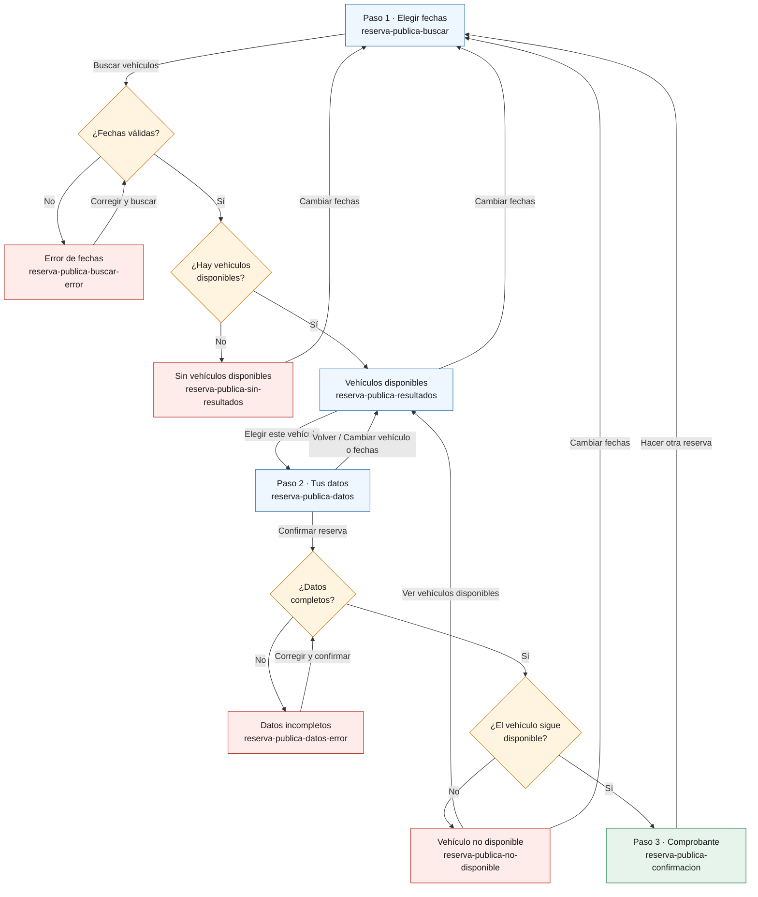

# Fase 5 — Parte 2 (chaarlyez): Reservas y formulario público

Alcance asignado en `00-asignacion.md` sección 6: base común del prototipo (✅ hecha, ver
sección 3 de ese documento), E5 Autogestión de Reservas del Cliente (formulario público) y E3
Reservas (back-office).

| Bloque | Estado |
|---|---|
| Formulario público (E5) — sección 1 | ✅ Mockups, capturas y diagrama de navegación |
| Reservas en el back-office (E3) — sección 2 | ⬜ Pendiente |

Para ver el prototipo: abrir `prototipo/reserva-publica-buscar.html` en el navegador (doble clic
alcanza) y navegar con los botones. Las capturas de cada pantalla principal en móvil (375 px) y
web (1280 px) están en `capturas/`.

---

## 1. Formulario público (E5) — US5.1, US5.2

Es la única UI que exige el MVP (RE08) y la usa el cliente sin ayuda de un empleado, por eso se
diseñó primero para celular (RNF08). Decisiones que aplican a todas sus pantallas:

- **Sin menú del back-office**: layout propio (`plantilla-publica.html`), una sola columna, con
  un indicador de 3 pasos: *1. Vehículo → 2. Tus datos → 3. Listo*.
- **Sin login ni cuenta** (RE08): el cliente completa sus datos en cada reserva.
- **Privacidad (RN10, RF44, RF58)**: ninguna pantalla dice si el documento ya estaba
  registrado ni si el cliente estaba inactivo. Para quien completa el formulario, la experiencia
  es idéntica si el cliente es nuevo, existente o inactivo; la reutilización o reactivación pasa
  sin mostrarse.
- **Al cliente no se le muestra la patente** del vehículo, solo marca, modelo, año, tipo y
  precio por día.
- **Contacto**: todas las pantallas tienen al pie el teléfono de la empresa para consultar o
  cancelar una reserva, porque esa gestión la hace el empleado (US3.3, US3.4); no hay
  autogestión de cancelación en el MVP. El número `11 5555-0000` es un dato de ejemplo.
- **Datos de ejemplo**: los vehículos salen de `02-dml.sql`. Del 20 al 23/11/2026 solo están
  disponibles el Fiat Cronos y la Toyota Hilux: el Yaris tiene un alquiler activo (RN14), la
  Ranger está en mantenimiento y el Argo está retirado. La clienta del ejemplo (Valentina Ruiz,
  DNI 40333444) es nueva, la misma del criterio de aceptación de RF44.

### 1.1 Paso 1 · Elegir fechas — `reserva-publica-buscar.html`

| | |
|---|---|
| **Objetivo** | Que el cliente indique cuándo quiere el vehículo, sin pedirle datos personales. |
| **Cubre** | US5.1, RF42 |
| **Campos** | Fecha de retiro `*`, fecha de devolución `*` (campos tipo `date`: en el celular abren el calendario nativo). |
| **Acciones** | *Buscar vehículos* → 1.3 (o 1.2 / 1.4 si hay error o no hay resultados). |
| **Móvil** | Estándar. |

### 1.2 Error de fechas — `reserva-publica-buscar-error.html`

| | |
|---|---|
| **Cuándo** | La fecha de devolución no es posterior a la de retiro. |
| **Cubre** | RF26 (vía RF45: mismas validaciones que la reserva del empleado) |
| **Mensajes** | Aviso general: *"Revisá las fechas para poder buscar."* Bajo el campo de devolución: *"La fecha de devolución tiene que ser posterior a la de retiro."* |
| **Acciones** | Corregir y *Buscar vehículos*. |
| **Móvil** | Estándar. |

### 1.3 Vehículos disponibles — `reserva-publica-resultados.html`

| | |
|---|---|
| **Objetivo** | Mostrar solo los vehículos que se pueden reservar en ese rango. |
| **Cubre** | US5.1, RF42 (misma lógica de disponibilidad que US1.5: RF13, RN12, RN14; excluye Retirados y en Mantenimiento) |
| **Muestra** | Rango elegido y, por vehículo: marca, modelo, año, tipo y precio por día. |
| **Acciones** | *Elegir este vehículo* → 1.5 · *Cambiar fechas* → 1.1. |
| **Móvil** | Cada vehículo es una tarjeta con el botón a lo ancho. En web, las mismas tarjetas en la columna centrada. |

### 1.4 Sin vehículos disponibles — `reserva-publica-sin-resultados.html`

| | |
|---|---|
| **Cuándo** | Ningún vehículo está libre en el rango pedido. |
| **Cubre** | US5.1 (criterio de US1.5: *"se informa claramente que no hay unidades disponibles"*) |
| **Mensaje** | *"No hay vehículos disponibles para esas fechas. Probá con otras fechas o llamanos al 11 5555-0000."* |
| **Acciones** | *Cambiar fechas* → 1.1. |
| **Móvil** | Estándar. |

### 1.5 Paso 2 · Tus datos — `reserva-publica-datos.html`

| | |
|---|---|
| **Objetivo** | Tomar los datos del cliente y confirmar la reserva. |
| **Cubre** | US5.2, RF43, RF44, RF58 |
| **Muestra** | Resumen de lo elegido (vehículo, retiro, devolución, precio por día) con la aclaración *"El monto final se calcula al devolver el vehículo, según los días de uso"* (RN13: el monto depende de la devolución real, por eso no se muestra un total). |
| **Campos** | Nombre `*`, apellido `*`, documento (DNI) `*`, email, teléfono. Al menos uno de email o teléfono es obligatorio; se aclara con un texto de ayuda arriba de esos dos campos. |
| **Acciones** | *Confirmar reserva* → 1.8 (o 1.6 / 1.7 si hay error) · *Volver* o *Cambiar vehículo o fechas* → 1.3. |
| **Móvil** | Es la pantalla más larga. Los campos usan el tipo que corresponde para que el celular muestre el teclado adecuado: `inputmode="numeric"` en el documento, `type="email"` y `type="tel"`. Además llevan `autocomplete`, para que el navegador pueda completar nombre, email y teléfono. |

### 1.6 Datos incompletos — `reserva-publica-datos-error.html`

| | |
|---|---|
| **Cuándo** | Falta algún obligatorio, o no se completó ni email ni teléfono. |
| **Cubre** | RF43, RNF01 |
| **Mensajes** | Aviso general: *"No pudimos registrar la reserva: revisá los campos marcados."* Bajo el documento: *"Ingresá tu número de documento."* (mismo patrón para nombre y apellido). Email y teléfono marcados juntos, con *"Ingresá un email o un teléfono."* debajo del último. |
| **Acciones** | Corregir y *Confirmar reserva*. |
| **Móvil** | Estándar. |

### 1.7 Vehículo no disponible — `reserva-publica-no-disponible.html`

| | |
|---|---|
| **Cuándo** | Al confirmar, el vehículo ya no está libre: otra persona (o un empleado) lo reservó mientras el cliente completaba sus datos. La disponibilidad se vuelve a validar al guardar. |
| **Cubre** | RF45 (RF28: RN12, RN14) |
| **Mensaje** | *"El Fiat Cronos 2023 se reservó para esas fechas mientras completabas tus datos. Tu reserva no se registró."* |
| **Acciones** | *Ver vehículos disponibles* → 1.3 · *Cambiar fechas* → 1.1. |
| **Móvil** | Estándar. |

### 1.8 Paso 3 · Comprobante — `reserva-publica-confirmacion.html`

| | |
|---|---|
| **Objetivo** | Confirmar que la reserva se registró y explicar qué sigue. |
| **Cubre** | US5.2, RN09 (la reserva nace Pendiente) |
| **Muestra** | Número de reserva (N° 4 en el ejemplo, porque `02-dml.sql` ya carga las reservas 1 a 3), estado *Pendiente*, vehículo, fechas, precio por día y a nombre de quién está. |
| **Mensaje** | *"Tu reserva queda pendiente hasta que la confirmemos (por ejemplo, con una seña). Para confirmarla, consultarla o cancelarla, llamanos al 11 5555-0000 e indicá el número de reserva."* (US3.5: la confirmación la hace el empleado). |
| **Acciones** | *Hacer otra reserva* → 1.1. |
| **Móvil** | Estándar. |

---

## 2. Reservas en el back-office (E3) — US3.1 a US3.5

⬜ **Pendiente.** Alcance en `00-asignacion.md` sección 6: listado con filtros
(`reservas-listado.html`), crear reserva con validación de solapamiento, confirmar, cancelar, y
link a *Iniciar alquiler* (Parte 3) desde una reserva Confirmada.

---

## 3. Diagrama de navegación

### 3.1 Formulario público

Azul: pantallas del flujo normal · rojo: errores y estados vacíos · naranja: validaciones del
sistema · verde: fin. Fuente editable:
[`fuentes/parte2-navegacion-formulario-publico.mmd`](fuentes/parte2-navegacion-formulario-publico.mmd).

### 3.2 Reservas en el back-office

⬜ Pendiente (junto con la sección 2).

---

## 4. Trazabilidad

| Requerimiento / regla | Pantalla |
|---|---|
| US5.1, RF42 | 1.1, 1.3, 1.4 |
| US5.2, RF43 | 1.5, 1.6, 1.8 |
| RF44, RF58, RN10 (reutilizar o reactivar cliente sin mostrarlo) | 1.5 (decisión de privacidad, sección 1) |
| RF45 (mismas validaciones que el empleado: RF26, RF28) | 1.2, 1.7 |
| RN09 (la reserva nace Pendiente) | 1.8 |
| RNF01 (mensajes de error claros) | 1.2, 1.6, 1.7 |
| RNF08 (formulario usable en celular y escritorio) | Todas (capturas en `capturas/`) |
| RE08 (sin login; solo el formulario público necesita UI) | Todas |

---

## 5. Qué falta validar

Formulario público (sección 1):

- [ ] ¿Los 3 pasos y las pantallas de error cubren bien US5.1 y US5.2?
- [ ] ¿Los textos de los mensajes son claros para un cliente sin ayuda (RNF01)?
- [ ] ¿Está bien no mostrar un monto total estimado en el paso 2, solo el precio por día (por
      RN13 el monto depende de la devolución real)?
- [ ] ¿Se ve bien en celular y en escritorio? (revisar las capturas de `capturas/` o abrir las
      pantallas con el modo dispositivo del navegador).

Puntos abiertos que salieron al diseñar (se resuelven en la revisión de integración, sin
reabrir fases cerradas):

- [ ] **Reservas con fecha pasada**: ninguna regla impide elegir una fecha de retiro anterior a
      hoy (RF26 solo compara devolución contra retiro). ¿Se agrega una validación, o se deja
      para la Fase 6?
- [ ] **Cliente creado aunque la reserva falle**: en la secuencia 3.2 de la Fase 3, el cliente
      se busca, crea o reactiva *antes* de validar la disponibilidad. Si el vehículo dejó de
      estar disponible (pantalla 1.7), quedaría un cliente creado o reactivado sin reserva. En la
      Fase 6, crear o reactivar el cliente y guardar la reserva tendría que ser una sola
      operación (una transacción) para que la pantalla 1.7 pueda decir *"Tu reserva no se
      registró"* sin dejar nada a medias.
- [ ] **Formato del documento**: no hay regla sobre su formato (¿solo números? ¿largo?). El
      mockup asume DNI numérico.

Reservas en el back-office (sección 2): pendiente.
