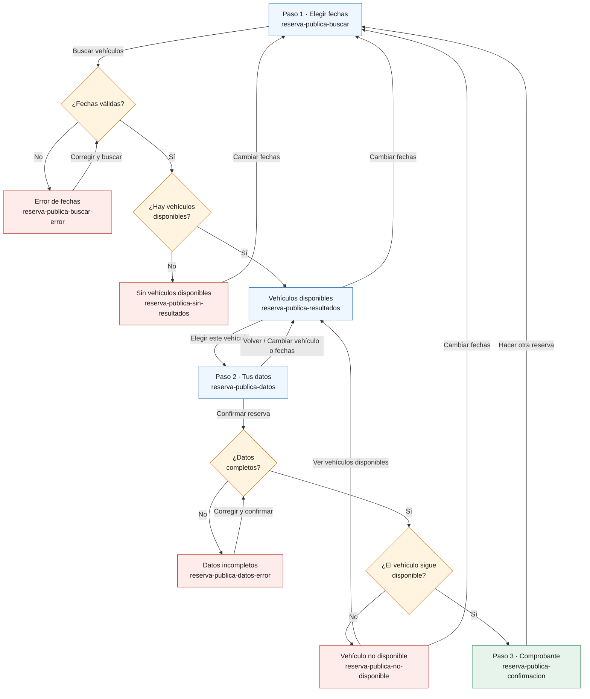
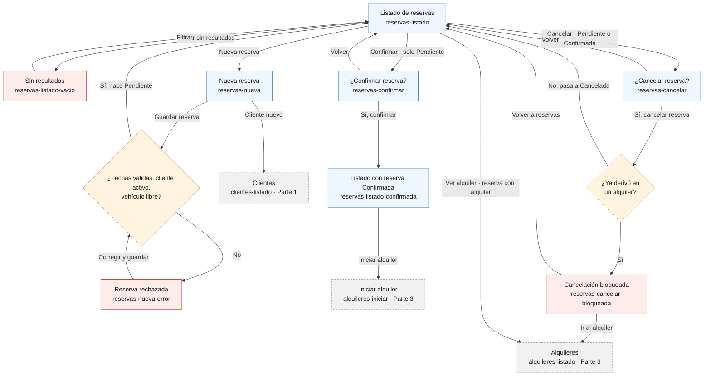

# Fase 5 — Parte 2 (chaarlyez): Reservas y formulario público

Alcance asignado en `00-asignacion.md` sección 6: base común del prototipo (✅ hecha, ver
sección 3 de ese documento), E5 Autogestión de Reservas del Cliente (formulario público) y E3
Reservas (back-office).

| Bloque | Estado |
|---|---|
| Formulario público (E5) — sección 1 | ✅ Mockups, capturas y diagrama de navegación |
| Reservas en el back-office (E3) — sección 2 | ✅ Mockups, capturas y diagrama de navegación |

Para ver el prototipo: abrir `prototipo/reserva-publica-buscar.html` (formulario público) o
`prototipo/reservas-listado.html` (back-office) en el navegador (doble clic alcanza) y navegar con
los botones. Las capturas de cada pantalla principal en móvil (375 px) y
web (1280 px) están en `capturas/`.

---

## 1. Formulario público (E5) — US5.1, US5.2

Es la única UI que exige el MVP (RE08) y la usa el cliente sin ayuda de un empleado, por eso se
diseñó primero para celular (RNF08). Decisiones que aplican a todas sus pantallas:

- **Sin menú del back-office**: layout propio (`plantilla-publica.html`), una sola columna, con
  un indicador de 3 pasos: *1. Vehículo → 2. Tus datos → 3. Listo*.
- **Sin login ni cuenta** (RE08): el cliente completa sus datos en cada reserva.
- **Privacidad (RN10, RF44, RF58)**: ninguna pantalla dice si el documento ya estaba
  registrado ni si el cliente estaba inactivo. Para quien completa el formulario, la experiencia
  es idéntica si el cliente es nuevo, existente o inactivo; la reutilización o reactivación pasa
  sin mostrarse.
- **Al cliente no se le muestra la patente** del vehículo, solo marca, modelo, año, tipo y
  precio por día.
- **Contacto**: todas las pantallas tienen al pie el teléfono de la empresa para consultar o
  cancelar una reserva, porque esa gestión la hace el empleado (US3.3, US3.4); no hay
  autogestión de cancelación en el MVP. El número `11 5555-0000` es un dato de ejemplo.
- **Datos de ejemplo**: los vehículos salen de `02-dml.sql`. Del 20 al 23/11/2026 solo están
  disponibles el Fiat Cronos y la Toyota Hilux: el Yaris tiene un alquiler activo (RN14), la
  Ranger está en mantenimiento y el Argo está retirado. La clienta del ejemplo (Valentina Ruiz,
  DNI 40333444) es nueva, la misma del criterio de aceptación de RF44.

### 1.1 Paso 1 · Elegir fechas — `reserva-publica-buscar.html`

| | |
|---|---|
| **Objetivo** | Que el cliente indique cuándo quiere el vehículo, sin pedirle datos personales. |
| **Cubre** | US5.1, RF42 |
| **Campos** | Fecha de retiro `*`, fecha de devolución `*` (campos tipo `date`: en el celular abren el calendario nativo). |
| **Acciones** | *Buscar vehículos* → 1.3 (o 1.2 / 1.4 si hay error o no hay resultados). |
| **Móvil** | Estándar. |

### 1.2 Error de fechas — `reserva-publica-buscar-error.html`

| | |
|---|---|
| **Cuándo** | La fecha de devolución no es posterior a la de retiro. |
| **Cubre** | RF26 (vía RF45: mismas validaciones que la reserva del empleado) |
| **Mensajes** | Aviso general: *"Revisá las fechas para poder buscar."* Bajo el campo de devolución: *"La fecha de devolución tiene que ser posterior a la de retiro."* |
| **Acciones** | Corregir y *Buscar vehículos*. |
| **Móvil** | Estándar. |

### 1.3 Vehículos disponibles — `reserva-publica-resultados.html`

| | |
|---|---|
| **Objetivo** | Mostrar solo los vehículos que se pueden reservar en ese rango. |
| **Cubre** | US5.1, RF42 (misma lógica de disponibilidad que US1.5: RF13, RN12, RN14; excluye Retirados y en Mantenimiento) |
| **Muestra** | Rango elegido y, por vehículo: marca, modelo, año, tipo y precio por día. |
| **Acciones** | *Elegir este vehículo* → 1.5 · *Cambiar fechas* → 1.1. |
| **Móvil** | Cada vehículo es una tarjeta con el botón a lo ancho. En web, las mismas tarjetas en la columna centrada. |

### 1.4 Sin vehículos disponibles — `reserva-publica-sin-resultados.html`

| | |
|---|---|
| **Cuándo** | Ningún vehículo está libre en el rango pedido. |
| **Cubre** | US5.1 (criterio de US1.5: *"se informa claramente que no hay unidades disponibles"*) |
| **Mensaje** | *"No hay vehículos disponibles para esas fechas. Probá con otras fechas o llamanos al 11 5555-0000."* |
| **Acciones** | *Cambiar fechas* → 1.1. |
| **Móvil** | Estándar. |

### 1.5 Paso 2 · Tus datos — `reserva-publica-datos.html`

| | |
|---|---|
| **Objetivo** | Tomar los datos del cliente y confirmar la reserva. |
| **Cubre** | US5.2, RF43, RF44, RF58 |
| **Muestra** | Resumen de lo elegido (vehículo, retiro, devolución, precio por día) con la aclaración *"El monto final se calcula al devolver el vehículo, según los días de uso"* (RN13: el monto depende de la devolución real, por eso no se muestra un total). |
| **Campos** | Nombre `*`, apellido `*`, documento (DNI) `*`, email, teléfono. Al menos uno de email o teléfono es obligatorio; se aclara con un texto de ayuda arriba de esos dos campos. |
| **Acciones** | *Confirmar reserva* → 1.8 (o 1.6 / 1.7 si hay error) · *Volver* o *Cambiar vehículo o fechas* → 1.3. |
| **Móvil** | Es la pantalla más larga. Los campos usan el tipo que corresponde para que el celular muestre el teclado adecuado: `inputmode="numeric"` en el documento, `type="email"` y `type="tel"`. Además llevan `autocomplete`, para que el navegador pueda completar nombre, email y teléfono. |

### 1.6 Datos incompletos — `reserva-publica-datos-error.html`

| | |
|---|---|
| **Cuándo** | Falta algún obligatorio, o no se completó ni email ni teléfono. |
| **Cubre** | RF43, RNF01 |
| **Mensajes** | Aviso general: *"No pudimos registrar la reserva: revisá los campos marcados."* Bajo el documento: *"Ingresá tu número de documento."* (mismo patrón para nombre y apellido). Email y teléfono marcados juntos, con *"Ingresá un email o un teléfono."* debajo del último. |
| **Acciones** | Corregir y *Confirmar reserva*. |
| **Móvil** | Estándar. |

### 1.7 Vehículo no disponible — `reserva-publica-no-disponible.html`

| | |
|---|---|
| **Cuándo** | Al confirmar, el vehículo ya no está libre: otra persona (o un empleado) lo reservó mientras el cliente completaba sus datos. La disponibilidad se vuelve a validar al guardar. |
| **Cubre** | RF45 (RF28: RN12, RN14) |
| **Mensaje** | *"El Fiat Cronos 2023 se reservó para esas fechas mientras completabas tus datos. Tu reserva no se registró."* |
| **Acciones** | *Ver vehículos disponibles* → 1.3 · *Cambiar fechas* → 1.1. |
| **Móvil** | Estándar. |

### 1.8 Paso 3 · Comprobante — `reserva-publica-confirmacion.html`

| | |
|---|---|
| **Objetivo** | Confirmar que la reserva se registró y explicar qué sigue. |
| **Cubre** | US5.2, RN09 (la reserva nace Pendiente) |
| **Muestra** | Número de reserva (N° 4 en el ejemplo, porque `02-dml.sql` ya carga las reservas 1 a 3), estado *Pendiente*, vehículo, fechas, precio por día y a nombre de quién está. |
| **Mensaje** | *"Tu reserva queda pendiente hasta que la confirmemos (por ejemplo, con una seña). Para confirmarla, consultarla o cancelarla, llamanos al 11 5555-0000 e indicá el número de reserva."* (US3.5: la confirmación la hace el empleado). |
| **Acciones** | *Hacer otra reserva* → 1.1. |
| **Móvil** | Estándar. |

---

## 2. Reservas en el back-office (E3) — US3.1 a US3.5

Usa el layout del back-office (`plantilla.html`) y los patrones comunes de listado, formulario
y confirmación (`00-asignacion.md` sección 3). Decisiones que aplican a todas sus pantallas:

- **Las acciones dependen del estado**: el listado solo ofrece lo que se puede hacer con cada
  reserva, para no llevar al empleado a un error evitable:

  | Estado de la reserva | Acciones en el listado |
  |---|---|
  | Pendiente | Confirmar · Cancelar |
  | Confirmada, sin alquiler | Iniciar alquiler (Parte 3) · Cancelar |
  | Confirmada, con alquiler | Ver alquiler (Parte 3) — no se ofrece cancelar (RF31) |
  | Cancelada | Ninguna (no se reactiva: si el cliente cambia de idea, se crea otra) |

- **Datos de ejemplo**: las reservas 1 a 3 de `02-dml.sql` más la N° 4, que es la que creó
  Valentina Ruiz en el formulario público (sección 1.8). Así los dos flujos cuentan la misma
  historia: el cliente reserva desde el celular, la reserva aparece Pendiente en el back-office y
  el empleado la confirma.
- **En el prototipo** están conectadas las acciones de la reserva N° 4 (*Confirmar*) y de la N° 2
  (*Cancelar*); los otros botones de las mismas acciones son iguales y no llevan a ningún lado.
- **Después de guardar, confirmar o cancelar** se vuelve al listado con un aviso de éxito arriba
  (ejemplo en 2.6: *"La reserva N° 4 quedó confirmada."*).

### 2.1 Listado de reservas — `reservas-listado.html`

| | |
|---|---|
| **Objetivo** | Seguimiento de las reservas y punto de partida de todas las acciones. |
| **Cubre** | US3.3, RF29, RF53, RN15 |
| **Filtros** | Cliente (documento o apellido), vehículo (patente), estado. Por defecto *Pendientes y confirmadas*: las canceladas se ven eligiendo *Cancelada* o *Todas* (RF53). |
| **Columnas** | N°, cliente, vehículo (patente · marca y modelo), retiro, devolución, estado, acciones (según la tabla de arriba). |
| **Acciones** | *Nueva reserva* → 2.3 · *Confirmar* → 2.5 · *Cancelar* → 2.7 · *Iniciar alquiler* / *Ver alquiler* → Parte 3. |
| **Móvil** | Estándar: filtros uno debajo del otro y cada reserva como tarjeta, con sus botones al pie. |

### 2.2 Sin resultados — `reservas-listado-vacio.html`

| | |
|---|---|
| **Cuándo** | Los filtros no devuelven ninguna reserva. |
| **Mensaje** | *"No hay reservas que coincidan con los filtros. Las reservas canceladas no se muestran: elegí "Cancelada" o "Todas" en Estado para verlas."* La segunda frase evita que el empleado crea que una reserva cancelada se borró (RN15). En el ejemplo se busca "Pereyra", que solo tiene la reserva N° 3, cancelada. |
| **Móvil** | Estándar. |

### 2.3 Nueva reserva — `reservas-nueva.html`

| | |
|---|---|
| **Objetivo** | Que el empleado cree una reserva para un cliente (por ejemplo, uno que llama por teléfono). |
| **Cubre** | US3.1, RF25 |
| **Campos** | Documento del cliente `*` (al completarlo se muestra el nombre del cliente encontrado), vehículo `*` (lista con patente, marca, modelo y año; los Retirados no aparecen y los que están alquilados o en mantenimiento lo indican entre paréntesis), fecha de inicio `*`, fecha de fin `*`. |
| **Acciones** | *Guardar reserva* → listado con aviso *"Reserva N° 5 creada (Pendiente)."* (RN09), o 2.4 si se rechaza · *Cancelar* → 2.1 · *Registralo en Clientes* → Parte 1. |
| **Móvil** | Estándar. El documento usa `inputmode="numeric"` y las fechas, el calendario nativo. |

### 2.4 Reserva rechazada — `reservas-nueva-error.html`

| | |
|---|---|
| **Cuándo** | Al guardar, alguna validación falla. El mockup muestra el caso principal, el **solapamiento** (US3.2): Martín Gómez pide el Fiat Cronos del 22 al 25/11/2026 y choca con la reserva N° 4 (20 al 23/11). |
| **Cubre** | US3.2, RF26, RF27, RF28, RN12, RN14, RN17, RNF01 |
| **Móvil** | Estándar. |

Mensajes de este formulario (todos con aviso general arriba y el campo marcado en rojo):

| Validación | Mensaje |
|---|---|
| Solapamiento con otra reserva (RF28, RN12) — *el del mockup* | *"No se puede reservar el Fiat Cronos (AB123CD) del 22/11/2026 al 25/11/2026: se superpone con la reserva N° 4 (Pendiente) del 20/11/2026 al 23/11/2026. Elegí otras fechas u otro vehículo."* |
| Vehículo con alquiler activo (RF28, RN14) | *"No se puede reservar el Toyota Yaris (AC456EF): tiene un alquiler activo sin fecha de devolución. Se podrá reservar cuando se registre la devolución."* |
| Fin no posterior al inicio (RF26) | Bajo *Fecha de fin*: *"La fecha de fin tiene que ser posterior a la de inicio."* |
| Cliente inactivo (RF27, RN17) | Bajo *Documento*: *"Diego Ramírez está dado de baja. Reactivalo desde Clientes para poder reservarle."* |
| Cliente inexistente (RF27) | Bajo *Documento*: *"No hay ningún cliente con ese documento. Registralo en Clientes."* |
| Falta un obligatorio | Bajo el campo: *"Completá este campo."* |

### 2.5 Confirmar reserva — `reservas-confirmar.html`

| | |
|---|---|
| **Cuándo** | *Confirmar* en una reserva Pendiente (el listado no lo ofrece en otro estado, RF33). |
| **Cubre** | US3.5, RF32, RF33 |
| **Muestra** | Cliente con su documento, vehículo, fechas y estado actual, más la explicación: confirmarla cuando el cliente la validó (por ejemplo, con una seña), y que desde Confirmada se puede iniciar el alquiler. |
| **Acciones** | *Sí, confirmar* → 2.6 · *Volver* → 2.1. |
| **Móvil** | Estándar. |

### 2.6 Listado con la reserva confirmada — `reservas-listado-confirmada.html`

| | |
|---|---|
| **Objetivo** | Mostrar el resultado de confirmar y el **enlace con la Parte 3**: la reserva N° 4, ahora Confirmada, ofrece *Iniciar alquiler* (`alquileres-iniciar.html`, US4.1). |
| **Mensaje** | Aviso de éxito: *"La reserva N° 4 quedó confirmada."* |
| **Móvil** | Estándar. |

### 2.7 Cancelar reserva — `reservas-cancelar.html`

| | |
|---|---|
| **Cuándo** | *Cancelar* en una reserva Pendiente o Confirmada que no derivó en alquiler. |
| **Cubre** | US3.4, RF30, RF53, RN03, RN15 |
| **Mensaje** | Explica qué pasa: la reserva pasa a Cancelada, el vehículo queda libre en esas fechas, deja de aparecer en el listado pero no se borra (se ve filtrando por estado), y no se puede volver a activar. Nunca dice "eliminar". |
| **Acciones** | *Sí, cancelar reserva* (botón rojo) → listado con aviso *"La reserva N° 2 quedó cancelada."* · *Volver* → 2.1. |
| **Móvil** | Estándar: los botones quedan uno debajo del otro, el rojo arriba. |

### 2.8 Cancelación bloqueada — `reservas-cancelar-bloqueada.html`

| | |
|---|---|
| **Cuándo** | Se intenta cancelar una reserva que ya derivó en un alquiler. El listado no ofrece *Cancelar* en ese caso, pero puede pasar si otro empleado inició el alquiler mientras tanto (y en la Fase 6, si el back-office queda solo como API, es la respuesta del endpoint). |
| **Cubre** | RF31, y su relación con US4.5 / RF56 |
| **Mensaje** | *"La reserva ya se convirtió en un alquiler (iniciado el 01/04/2026, Activo). Una reserva que derivó en un alquiler no se puede cancelar."* Más la salida: *"Si el alquiler se registró por error, anulalo desde Alquileres: al anularlo, esta reserva pasa a Cancelada automáticamente."* |
| **Acciones** | *Ir al alquiler* → Parte 3 · *Volver a reservas* → 2.1. |
| **Móvil** | Estándar. |

---

## 3. Diagrama de navegación

### 3.1 Formulario público

Azul: pantallas del flujo normal · rojo: errores y estados vacíos · naranja: validaciones del
sistema · verde: fin. Fuente editable:
[`fuentes/parte2-navegacion-formulario-publico.mmd`](fuentes/parte2-navegacion-formulario-publico.mmd).

### 3.2 Reservas en el back-office

Mismos colores que 3.1; en gris con borde punteado, las pantallas de otras partes a las que se
enlaza. Fuente editable:
[`fuentes/parte2-navegacion-reservas-backoffice.mmd`](fuentes/parte2-navegacion-reservas-backoffice.mmd).

---

## 4. Trazabilidad

| Requerimiento / regla | Pantalla |
|---|---|
| US5.1, RF42 | 1.1, 1.3, 1.4 |
| US5.2, RF43 | 1.5, 1.6, 1.8 |
| RF44, RF58, RN10 (reutilizar o reactivar cliente sin mostrarlo) | 1.5 (decisión de privacidad, sección 1) |
| RF45 (mismas validaciones que el empleado: RF26, RF28) | 1.2, 1.7 |
| RN09 (la reserva nace Pendiente) | 1.8 |
| RNF01 (mensajes de error claros) | 1.2, 1.6, 1.7 |
| RNF08 (formulario usable en celular y escritorio) | Todas (capturas en `capturas/`) |
| RE08 (sin login; solo el formulario público necesita UI) | Todas las de la sección 1 |
| US3.1, RF25 | 2.3 |
| US3.2, RF28, RN12, RN14 | 2.4 |
| RF26, RF27, RN17 | 2.4 (tabla de mensajes) |
| US3.3, RF29 | 2.1, 2.2 |
| US3.4, RF30, RN03 | 2.7 |
| RF31 | 2.1 (no se ofrece cancelar), 2.8 |
| RF53, RN15 | 2.1, 2.2, 2.7 |
| US3.5, RF32, RF33 | 2.1 (solo en Pendientes), 2.5, 2.6 |
| RN09 (la reserva nace Pendiente) | 1.8, 2.3 |
| US4.1 (enlace a la Parte 3) | 2.6 |
| US4.5, RF56 (enlace a la Parte 3) | 2.8 |

---

## 5. Qué falta validar

Formulario público (sección 1):

- [ ] ¿Los 3 pasos y las pantallas de error cubren bien US5.1 y US5.2?
- [ ] ¿Los textos de los mensajes son claros para un cliente sin ayuda (RNF01)?
- [ ] ¿Está bien no mostrar un monto total estimado en el paso 2, solo el precio por día (por
      RN13 el monto depende de la devolución real)?
- [ ] ¿Se ve bien en celular y en escritorio? (revisar las capturas de `capturas/` o abrir las
      pantallas con el modo dispositivo del navegador).

Puntos abiertos que salieron al diseñar (se resuelven en la revisión de integración, sin
reabrir fases cerradas):

- [ ] **Reservas con fecha pasada**: ninguna regla impide elegir una fecha de retiro anterior a
      hoy (RF26 solo compara devolución contra retiro). ¿Se agrega una validación, o se deja
      para la Fase 6?
- [ ] **Cliente creado aunque la reserva falle**: en la secuencia 3.2 de la Fase 3, el cliente
      se busca, crea o reactiva *antes* de validar la disponibilidad. Si el vehículo dejó de
      estar disponible (pantalla 1.7), quedaría un cliente creado o reactivado sin reserva. En la
      Fase 6, crear o reactivar el cliente y guardar la reserva tendría que ser una sola
      operación (una transacción) para que la pantalla 1.7 pueda decir *"Tu reserva no se
      registró"* sin dejar nada a medias.
- [ ] **Formato del documento**: no hay regla sobre su formato (¿solo números? ¿largo?). El
      mockup asume DNI numérico.

Reservas en el back-office (sección 2):

- [ ] ¿Las pantallas cubren bien US3.1 a US3.5?
- [ ] ¿Está bien que el listado muestre solo las acciones posibles según el estado (tabla de la
      sección 2), en vez de ofrecer todas y mostrar el error?
- [ ] ¿Los mensajes de la tabla de 2.4 son claros y dicen qué regla falló (RNF01)?
- [ ] ¿Se ve bien en celular y en escritorio?
- [ ] ¿Los nombres de las pantallas de la Parte 3 a las que se enlaza (`alquileres-iniciar.html`,
      `alquileres-listado.html`) coinciden con lo que entregue mariocardona970546? → se confirma
      en la revisión de integración.

Puntos abiertos:

- [ ] **Reservar un vehículo en mantenimiento**: RF27 y RF28 solo impiden reservar un vehículo
      Retirado o con alquiler activo, así que el empleado puede reservar uno en mantenimiento
      para más adelante (por ejemplo, cuando termina el service). En cambio, la búsqueda de
      disponibilidad y el formulario público no lo muestran (US1.6). El mockup lo permite y lo
      marca *(en mantenimiento)* en la lista. ¿Es lo que se quiere?
- [ ] **Reservas pendientes vencidas**: en los datos de ejemplo, la reserva N° 2 sigue
      Pendiente aunque sus fechas (mayo de 2026) ya pasaron. Ninguna regla dice qué pasa con una
      reserva que nunca se confirmó ni se canceló. Para el MVP alcanza con que el empleado la
      cancele a mano.
