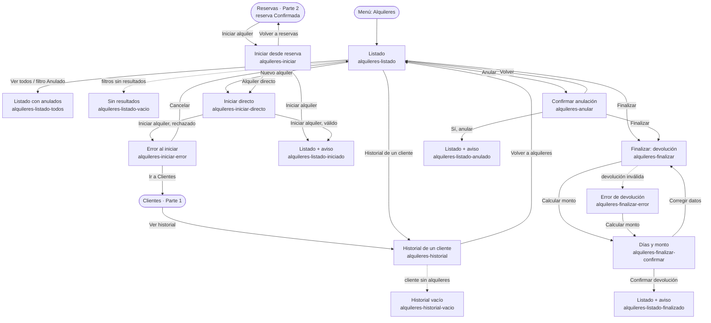
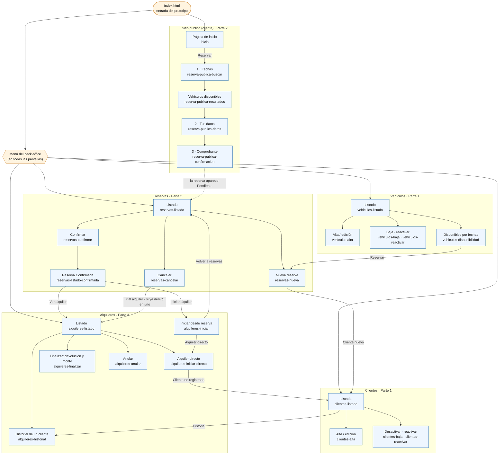

# Fase 5 — Parte 3 (mariocardona970546): Alquileres e integración final

Alcance asignado en `00-asignacion.md` sección 7: E4 Alquileres (back-office) e integración final
del prototipo.

| Bloque | Estado |
|---|---|
| Alquileres en el back-office (E4) — secciones 1 a 3 | ✅ Mockups, capturas y diagrama de navegación |
| Integración final del prototipo — sección 4 | ✅ Revisión de las 50 pantallas, recorridos guiados y diagrama de navegación completo |

Para ver el prototipo: abrir `prototipo/alquileres-listado.html` en el navegador (doble clic
alcanza) y navegar con los botones. Las capturas de cada pantalla principal en móvil (375 px) y
web (1280 px) están en `capturas/`.

---

## 1. Decisiones que aplican a todas las pantallas

Usan el layout del back-office (`plantilla.html`) y los patrones comunes de listado, formulario y
confirmación (`00-asignacion.md` sección 3).

- **Las acciones dependen del estado**: igual que en reservas (Parte 2), el listado solo ofrece
  lo que se puede hacer con cada alquiler, para no llevar al empleado a un error evitable:

  | Estado del alquiler | Acciones en el listado |
  |---|---|
  | Activo | Finalizar · Anular |
  | Finalizado | Ver historial del cliente — ya no se anula ni se modifica (RN18: el monto ya se calculó) |
  | Anulado | Ninguna (solo aparece filtrando por estado) |

- **Fecha y hora**: el retiro y la devolución se cargan con fecha **y hora** (campo
  `datetime-local`), porque el monto se calcula por períodos de 24 horas desde el momento exacto
  del retiro (RN13). Las fechas de reserva, en cambio, son solo de día (RN12).
- **El monto se ve antes de guardar**: finalizar tiene dos pasos. Primero se carga la
  devolución, después se muestran los días efectivos y el monto, y recién ahí se confirma
  (`00-asignacion.md` sección 7). Nada se guarda en el primer paso.
- **Columna "Origen"**: cada alquiler dice si salió de una reserva (*Reserva N° 1*) o si fue
  *Directo* (RN04). Es lo que decide si al anularlo también se cancela una reserva (RF56).
- **Datos de ejemplo**: los alquileres 1 a 3 de `02-dml.sql`, más el N° 4, que es el que se
  inicia desde la reserva N° 4 de Valentina Ruiz (la que creó en el formulario público y el
  empleado confirmó, Parte 2). Así los 3 flujos cuentan la misma historia: la clienta reserva
  desde el celular, el empleado confirma la reserva y después le entrega el auto.
- **En el prototipo** están conectadas las acciones del alquiler N° 1 (*Finalizar* y *Anular*,
  como dos caminos alternativos) y el inicio desde la reserva N° 4. Los demás botones de las
  mismas acciones son iguales y no llevan a ningún lado.
- **Después de iniciar, finalizar o anular** se vuelve al listado con un aviso de éxito arriba,
  igual que en reservas.
- **Validación en el mockup**: los formularios (iniciar, nuevo alquiler directo, finalizar e
  historial) usan `validacion.js` de la base común, como pide la guía de estilo de la Parte 2:
  si falta un obligatorio, el documento tiene letras o la devolución es anterior al retiro, el
  error aparece en el momento y no se pasa a la pantalla siguiente. Las reglas de negocio
  (vehículo alquilado, cliente inactivo) no las puede saber el mockup, por eso se muestran en
  pantallas de error fijas (2.6, 2.9).

## 2. Pantallas

### 2.1 Listado de alquileres — `alquileres-listado.html`

| | |
|---|---|
| **Objetivo** | Saber qué vehículos están afuera y cuáles ya volvieron; punto de partida de todas las acciones. |
| **Cubre** | US4.3, RF40, RN15 |
| **Filtros** | Estado (por defecto *Activos y finalizados*; también Activo, Finalizado, Anulado y Todos), cliente (documento o apellido), vehículo (patente). |
| **Columnas** | N°, cliente, vehículo (patente · marca y modelo), retiro, devolución, origen, estado, monto, acciones (según la tabla de la sección 1). Un alquiler Activo muestra "—" en devolución y monto. |
| **Acciones** | *Nuevo alquiler* → 2.5 · *Historial de un cliente* → 2.13 · *Finalizar* → 2.8 · *Anular* → 2.11 · *Ver historial del cliente* → 2.13 · *Ver todos los alquileres* → 2.2. |
| **Móvil** | Estándar: filtros uno debajo del otro, y cada alquiler como tarjeta con sus botones al pie. Los dos botones de arriba (*Historial* y *Nuevo alquiler*) quedan en una fila debajo del título. |

### 2.2 Listado con anulados — `alquileres-listado-todos.html`

| | |
|---|---|
| **Cuándo** | El empleado elige *Todos* (o *Anulado*) en Estado, o toca *Ver todos los alquileres*. |
| **Cubre** | RF40, RN15, RN18, RNF09 |
| **Muestra** | Aparece el alquiler N° 3 (Sofía Pereyra, Anulado): sin devolución, con *"Sin monto"* y sin acciones. Se conserva para el historial, pero ya no cuenta como alquiler activo. |
| **Móvil** | Estándar. |

### 2.3 Sin resultados — `alquileres-listado-vacio.html`

| | |
|---|---|
| **Cuándo** | Los filtros no devuelven ningún alquiler. En el ejemplo: Estado *Activo* y cliente "Pereyra" (Sofía Pereyra solo tiene el N° 3, Anulado). |
| **Mensaje** | *"No hay alquileres que coincidan con los filtros. Los alquileres anulados no se muestran: elegí "Anulado" o "Todos" en Estado para verlos."* La segunda frase evita que el empleado crea que un alquiler anulado se borró (RN15). Es el mismo criterio que el listado vacío de reservas. |
| **Móvil** | Estándar. |

### 2.4 Iniciar alquiler desde una reserva — `alquileres-iniciar.html`

| | |
|---|---|
| **Objetivo** | Registrar el retiro del vehículo de un cliente que ya tenía la reserva confirmada. |
| **Cubre** | US4.1, RF34, RF35, RN04 |
| **Se llega** | Desde el botón *Iniciar alquiler* de una reserva Confirmada en el listado de reservas (Parte 2). |
| **Muestra** | Reserva N° 4 *Confirmada*: cliente con su documento, vehículo con su precio por día y las fechas reservadas. El cliente y el vehículo salen de la reserva y no se cambian en esta pantalla. |
| **Campos** | Fecha y hora de retiro `*` (por defecto, el momento actual), con la ayuda *"El alquiler se cobra por períodos de 24 horas desde este momento."* |
| **Acciones** | *Iniciar alquiler* → 2.7 · *Volver a reservas* → listado de reservas (Parte 2) · *Iniciar un alquiler directo* → 2.5. |
| **Móvil** | Estándar. La fecha y hora usan el selector nativo del celular. |

### 2.5 Nuevo alquiler directo — `alquileres-iniciar-directo.html`

| | |
|---|---|
| **Objetivo** | Alquilarle un vehículo a un cliente que llega sin reserva previa. |
| **Cubre** | US4.1, RF34, RF35, RN04, RN11 |
| **Campos** | Documento del cliente `*`, vehículo `*`, fecha y hora de retiro `*`. En la lista de vehículos no aparecen los Retirados (RN17); los que no se pueden alquilar lo dicen entre paréntesis (*alquilado*, *en mantenimiento*), igual que en *Nueva reserva* (Parte 2). |
| **Acciones** | *Iniciar alquiler* → listado con aviso *"Alquiler N° 5 iniciado. El … pasó a Alquilado."* o 2.6 si se rechaza (en el prototipo, con los campos completos lleva siempre a 2.6, para mostrar el error; con campos vacíos, `validacion.js` marca el error sin salir de la pantalla) · *Cancelar* → 2.1 · *Registralo en Clientes* → Parte 1. |
| **Móvil** | Estándar. El documento usa `inputmode="numeric"` para que el celular muestre el teclado numérico. |

### 2.6 Alquiler rechazado — `alquileres-iniciar-error.html`

| | |
|---|---|
| **Cuándo** | Al iniciar, alguna validación falla. El mockup muestra a la vez los dos bloqueos de US4.1: el cliente Diego Ramírez está inactivo (RF54) y el Toyota Yaris ya está alquilado (RF36). |
| **Cubre** | US4.1, RF36, RF54, RN17, RNF01 |
| **Acciones** | Corregir e *Iniciar alquiler* · *Cancelar* → 2.1 · *Ir a Clientes* → Parte 1 (para reactivar al cliente, US2.5). |
| **Móvil** | Estándar. |

Mensajes al iniciar un alquiler (directo o desde reserva), todos con el aviso general
*"No se pudo iniciar el alquiler: revisá los campos marcados."* y el campo marcado en rojo:

| Validación | Mensaje |
|---|---|
| Vehículo ya alquilado (RF36) — *en el mockup* | Bajo *Vehículo*: *"El Toyota Yaris (AC456EF) ya está alquilado (alquiler N° 1). Elegí otro vehículo o registrá antes su devolución."* |
| Cliente inactivo (RF54, RN17) — *en el mockup* | Bajo *Documento*: *"Diego Ramírez está dado de baja. Reactivalo desde Clientes para poder alquilarle."* (mismo texto que en reservas, Parte 2) |
| Vehículo Retirado (RF54, RN17) | Bajo *Vehículo*: *"El Fiat Argo (AF345KL) está dado de baja. Reactivalo desde Vehículos para poder alquilarlo."* No debería pasar desde la pantalla, porque la lista no muestra los Retirados; queda para la API o por si otro empleado lo da de baja mientras tanto. |
| Cliente inexistente | Bajo *Documento*: *"No hay ningún cliente con ese documento. Registralo en Clientes."* |
| Falta un obligatorio | Bajo el campo, con el nombre del campo: *"Completá documento del cliente."* (lo arma `validacion.js`) |
| Documento con letras o puntos | Bajo *Documento*: *"El documento debe tener solo números, sin puntos ni letras."* (`validacion.js`) |
| Reserva que dejó de estar Confirmada (desde 2.4) | Aviso general: *"La reserva N° 4 ya no está confirmada (fue cancelada). No se puede iniciar el alquiler desde ella."* Pasa si otro empleado la canceló mientras tanto. |

### 2.7 Listado después de iniciar — `alquileres-listado-iniciado.html`

| | |
|---|---|
| **Muestra** | Aviso *"Alquiler N° 4 iniciado. El Fiat Cronos (AB123CD) pasó a Alquilado."* (RF35) y el alquiler N° 4 arriba, Activo, con origen *Reserva N° 4*. |
| **Móvil** | Estándar. |

### 2.8 Finalizar alquiler, paso 1: devolución — `alquileres-finalizar.html`

| | |
|---|---|
| **Objetivo** | Registrar la devolución del vehículo. |
| **Cubre** | US4.2, RF37, RF39 |
| **Muestra** | Datos del alquiler N° 1: cliente, vehículo con precio por día, retiro y origen. |
| **Campos** | Retiro (solo lectura, de referencia), fecha y hora de devolución `*` (con la ayuda *"Hay 1 hora de tolerancia: si se pasa, se cobra un día más."*), estado del vehículo al volver `*`: *Disponible (listo para alquilar)*, el valor por defecto, o *Mantenimiento (necesita revisión o limpieza)* (RF39). |
| **Acciones** | *Calcular monto* → 2.10 (o 2.9 si hay error) · *Volver* → 2.1. |
| **Móvil** | Estándar. |

### 2.9 Devolución inválida — `alquileres-finalizar-error.html`

| | |
|---|---|
| **Cuándo** | La fecha y hora de devolución es anterior al retiro. |
| **Cubre** | RF37, RNF01 |
| **Mensajes** | Aviso general: *"No se pudo calcular el monto: revisá los campos marcados."* Bajo la devolución: *"La devolución no puede ser anterior al retiro (01/04/2026 10:00)."* Si falta un obligatorio: *"Completá fecha y hora de devolución."* En el mockup, `validacion.js` muestra este error en vivo con su texto genérico: *"Esta fecha no puede ser anterior a la de retiro."* Por eso el paso 1 muestra el retiro como campo de solo lectura. |
| **Móvil** | Estándar. |

### 2.10 Finalizar alquiler, paso 2: días y monto — `alquileres-finalizar-confirmar.html`

| | |
|---|---|
| **Objetivo** | Que el empleado vea cuánto se cobra **antes** de cerrar el alquiler. |
| **Cubre** | US4.2, RF38, RF39, RN05, RN13, RN18 |
| **Muestra** | Retiro, devolución, cómo vuelve el vehículo, días efectivos, precio por día y monto total, con una explicación del cálculo y la advertencia *"Al confirmar, el alquiler queda Finalizado con este monto y ya no se puede anular ni modificar."* |
| **Acciones** | *Confirmar devolución* → 2.12 · *Corregir datos* → 2.8. |
| **Móvil** | Estándar. |

Cálculo (RN13: períodos de 24 h desde el retiro, con 1 hora de tolerancia), con el Toyota Yaris a
$ 85.000 por día y retiro el 01/04/2026 a las 10:00:

| Devolución | Días efectivos | Monto | Explicación que muestra la pantalla |
|---|---|---|---|
| 05/04/2026 10:40 — *el del mockup* | 4 | $ 340.000 | *"Se cuentan períodos de 24 horas desde el retiro. La devolución fue 40 minutos después del cuarto período: entra en la hora de tolerancia, así que no se cobra un día más."* |
| 05/04/2026 12:00 | 5 | $ 425.000 | *"… La devolución fue 2 horas después del cuarto período: supera la hora de tolerancia, así que se cobra un día más."* |
| 01/04/2026 18:00 (mismo día) | 1 | $ 85.000 | *"… Se cobra como mínimo un día."* (ver sección 5) |

### 2.11 Confirmar anulación — `alquileres-anular.html`

| | |
|---|---|
| **Objetivo** | Corregir un alquiler registrado por error, sin borrarlo. |
| **Cubre** | US4.5, RF55, RF56, RN15, RN18 |
| **Muestra** | Datos del alquiler N° 1, cuándo corresponde anular (*"Anulá solo si el alquiler se registró por error… Si el cliente devolvió el vehículo, usá Finalizar."*) y qué pasa al anular: el alquiler pasa a *Anulado* sin monto ni fecha de devolución, el vehículo vuelve a *Disponible* y, como este alquiler salió de la reserva N° 1, esa reserva pasa a *Cancelada* (RF56). En un alquiler directo esa línea no aparece. Nunca dice "eliminar" (RN15): aclara que el alquiler sigue en el historial. |
| **Acciones** | *Sí, anular* → 2.12 · *Volver* → 2.1 · *Finalizar* → 2.8. |
| **Móvil** | Estándar. |

Si el alquiler ya no está Activo al confirmar (otro empleado lo finalizó mientras tanto, RF57), se
vuelve al listado con el aviso de error *"El alquiler N° 1 ya está Finalizado y no se puede
anular: el monto ya se calculó."* No hace falta una pantalla aparte: desde el listado no se ofrece
anular un alquiler Finalizado.

### 2.12 Listado después de finalizar o anular — `alquileres-listado-finalizado.html`, `alquileres-listado-anulado.html`

| | |
|---|---|
| **Finalizado** | Aviso *"Alquiler N° 1 finalizado. Monto a cobrar: $ 340.000 (4 días). El Toyota Yaris (AC456EF) volvió a Disponible."* El N° 1 queda Finalizado, con su devolución y monto. |
| **Anulado** | Aviso *"Alquiler N° 1 anulado. El Toyota Yaris (AC456EF) volvió a Disponible y la reserva N° 1 pasó a Cancelada."* El N° 1 deja de verse en el listado por defecto (está Anulado, RF40); se ve con *Ver todos los alquileres*. |
| **Móvil** | Estándar. |

### 2.13 Historial de un cliente — `alquileres-historial.html`

| | |
|---|---|
| **Objetivo** | Atender a un cliente que llama con una consulta o reclamo. |
| **Cubre** | US4.4, RF41, RNF09 |
| **Se llega** | Desde *Historial de un cliente* o *Ver historial del cliente* en el listado, o desde un cliente (Parte 1). |
| **Campos** | Documento del cliente `*` y *Buscar*. |
| **Muestra** | El cliente (nombre, documento, estado Activo o Inactivo, contacto) y **todos** sus alquileres: activos, finalizados y anulados, con vehículo, retiro, devolución, días, estado y monto. A diferencia del listado, no oculta los anulados: es el historial completo. Sale aunque el cliente o el vehículo estén dados de baja (RF41); en ese caso el vehículo se muestra igual, con su patente. En el ejemplo, Martín Gómez con el alquiler N° 2. |
| **Acciones** | *Buscar* · *Volver a alquileres* → 2.1. |
| **Móvil** | Estándar: cada alquiler del historial como tarjeta. |

### 2.14 Historial vacío — `alquileres-historial-vacio.html`

| | |
|---|---|
| **Cuándo** | El cliente existe pero no tiene alquileres. El ejemplo usa a Diego Ramírez, que además está **inactivo**: se ve con la etiqueta *Inactivo* y la fecha de baja, para mostrar que estar dado de baja no lo oculta de esta búsqueda (RF41). |
| **Mensaje** | *"Diego Ramírez no tiene alquileres registrados."* Si no existe ningún cliente con ese documento: *"No hay ningún cliente con el documento 12345678."* (campo marcado en rojo). |
| **Móvil** | Estándar. |

## 3. Diagrama de navegación

Fuente editable: [`fuentes/parte3-navegacion-alquileres.mmd`](fuentes/parte3-navegacion-alquileres.mmd).
Las flechas punteadas son estados especiales a los que se llega por un resultado (un error o una
búsqueda sin resultados), no por un botón. Los óvalos son pantallas de las otras partes.

## 4. Integración final

Se hizo con las 3 partes ya en `main` (PR #1, #3 y #2), según `00-asignacion.md` sección 7.
El prototipo completo tiene **50 pantallas**.

### 4.1 Qué se revisó

- [x] **Links**: se revisaron todos los links de las 50 pantallas y ninguno lleva a un archivo
      que no existe. Los cruces entre partes funcionan: reserva Confirmada → *Iniciar alquiler*
      (2.4); *Ver alquiler* / *Ir al alquiler* → listado de alquileres; cliente → historial
      (2.13); disponibilidad de vehículos → nueva reserva.
- [x] **Menú**: en las 38 pantallas del back-office, la sección marcada en el menú coincide con
      la pantalla.
- [x] **Web y móvil**: las 50 pantallas se abrieron en 375 px y en 1280 px (100 revisiones) y
      ninguna se desborda hacia el costado.
- [x] **Validación de formularios** (`validacion.js`, guía de estilo): se probaron los 8
      formularios de alta y búsqueda enviándolos vacíos o con datos inválidos, y todos marcan
      el error sin pasar de pantalla.
- [x] **Capturas** de esta parte rehechas con el tema VeloRent.

### 4.2 Correcciones hechas en la integración

Cambios chicos sobre pantallas de otras partes, para que el prototipo quede parejo (se avisan
en el PR):

| Pantalla | Cambio | Por qué |
|---|---|---|
| `vehiculos-alta.html`, `clientes-alta.html`, `vehiculos-disponibilidad.html` (Parte 1) | Usan `validacion.js`: `data-validar`, `required` en los obligatorios, `data-numerico` en el documento, orden de fechas en la disponibilidad, y botón de envío en vez de link fijo. | La guía de estilo pide enlazarlo en toda pantalla con formulario. Los obligatorios son los de US1.1 y US2.1 (en el alta de clientes del back-office, email y teléfono son opcionales; la regla de "al menos uno" es solo del formulario público). |
| `vehiculos-disponibilidad.html` (Parte 1) | *Reservar* lleva a `reservas-nueva.html` en vez de al listado de reservas. | Desde un vehículo disponible, lo esperable es crear la reserva. |
| `clientes-listado.html` (Parte 1) | El *Historial* de Diego Ramírez lleva a `alquileres-historial-vacio.html`. | Esa pantalla muestra justo a Diego, inactivo y sin alquileres (RF41); antes abría el historial de Martín Gómez. |
| `index.html` | Se ordenó (había una sección repetida y un comentario viejo) y se agregaron **recorridos guiados** para presentar el prototipo. | Ver 4.3. |

### 4.3 Recorridos guiados (`index.html`)

Cuatro recorridos que cruzan las 3 partes con los mismos datos de ejemplo:

1. **De la reserva al alquiler**: Valentina Ruiz reserva desde el sitio público (Parte 2), el
   empleado confirma la reserva N° 4 (Parte 2) e inicia el alquiler N° 4 (Parte 3).
2. **Devolución y cobro**: finalizar el alquiler N° 1 con el cálculo de RN13 (Parte 3).
3. **Bajas sin borrar nada**: baja y reactivación de vehículos y clientes (Parte 1), cancelación
   de reservas (Parte 2), anulación de alquileres e historial de un cliente inactivo (Parte 3).
4. **Errores y validaciones**: un ejemplo de mensaje de error por sección.

### 4.4 Diagrama de navegación completo

Fuente editable: [`fuentes/integracion-navegacion-completa.mmd`](fuentes/integracion-navegacion-completa.mmd).
Muestra cada sección como un bloque con sus pantallas principales y todos los links que cruzan
de una parte a otra. El detalle de cada sección (errores, estados vacíos, confirmaciones) está en
el diagrama de su parte: `parte1-navegacion-vehiculos-clientes.mmd`,
`parte2-navegacion-formulario-publico.mmd`, `parte2-navegacion-reservas-backoffice.mmd` y el de
la sección 3 de este documento. La flecha punteada no es un link: indica que la reserva creada
en el sitio público aparece en el back-office.

### 4.5 Para resolver en la revisión de integración

- [ ] **Nombre en los encabezados**: la página de inicio dice "VeloRent" y el resto
      "Alquiler de Vehículos". Decidir cuál queda (pedido de chaarlyez en el PR #1).
- [ ] **`inicio.html`** (Parte 2) tiene estilos escritos en el HTML (`style="..."`), que la guía
      de estilo no permite, y muestra vehículos (BMW Serie 3, Porsche 911…) que no están en
      `02-dml.sql`. ¿Se pasan los estilos a `estilos.css` y se usan los vehículos de los datos
      de ejemplo, o se acepta la página de inicio como pieza de marketing?
- [ ] **Capturas de la Parte 1**: en el roadmap figuran como pendientes.
- [ ] Armar `04-revision-integracion.md` entre los 3 y cerrar la fase.

## 5. Qué falta validar

Alquileres en el back-office:

- [ ] ¿Las pantallas cubren bien US4.1 a US4.5?
- [ ] ¿Está bien que finalizar tenga dos pasos (devolución → días y monto → confirmar), para que el
      monto se vea antes de guardar?
- [ ] ¿Los mensajes de la sección 2.6 y de las pantallas 2.9 y 2.11 son claros y dicen qué regla
      falló (RNF01)?
- [ ] ¿Está bien que el historial (2.13) muestre también los alquileres anulados, a diferencia
      del listado?
- [ ] ¿Se ve bien en celular y en escritorio? (revisar las capturas de `capturas/` o abrir las
      pantallas con el modo dispositivo del navegador).
- [ ] ¿Los nombres de las pantallas de las otras partes a las que se enlaza
      (`reservas-listado.html`, `clientes-listado.html`) coinciden con lo entregado? → se confirma
      en la revisión de integración.

Puntos abiertos que salieron al diseñar (se resuelven en la revisión de integración, sin
reabrir fases cerradas):

- [ ] **Alquiler directo sobre un vehículo reservado**: RF36 y RF54 solo impiden alquilar un
      vehículo Alquilado o Retirado. Nada impide iniciar un alquiler directo del Fiat Cronos el
      19/11 aunque esté reservado para Valentina Ruiz del 20 al 23/11: como un alquiler activo no
      tiene fecha de fin, el vehículo podría no volver a tiempo. ¿Se bloquea, se avisa, o se deja
      al criterio del empleado? El mockup no lo bloquea.
- [ ] **Alquilar un vehículo en mantenimiento**: tampoco hay regla que lo impida. El mockup lo
      muestra en la lista marcado *(en mantenimiento)*, como en reservas (punto abierto de la
      Parte 2). ¿Se bloquea?
- [ ] **Devolución en el mismo día**: RN13 no dice qué pasa si el vehículo vuelve antes de
      completar 24 horas. El mockup asume que se cobra **un día como mínimo** (es lo habitual en
      la industria). Confirmar.
- [ ] **Retiro distinto de la reserva**: si el cliente retira el vehículo antes o después de la
      fecha de inicio reservada, ¿se permite? El mockup lo permite (la fecha de retiro es
      editable) y no muestra ningún aviso.
- [ ] **Datos de ejemplo**: el alquiler N° 1 de `02-dml.sql` sigue Activo desde el 01/04/2026,
      aunque su reserva terminaba el 05/04/2026. El mockup lo finaliza con devolución el
      05/04/2026, como si se registrara la devolución en fecha. No cambia ninguna regla, solo la
      historia de los datos.
